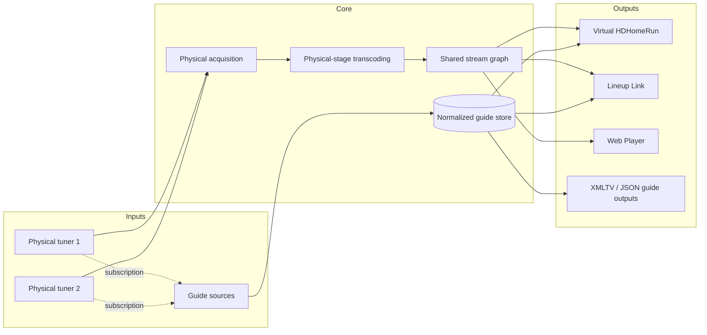

# Lineup

**Lineup** is a .NET live-TV routing and guide platform for composing physical tuner inputs, normalized guide sources, shared streaming pipelines, and consumer-facing virtual tuner outputs.

It includes a Blazor management UI, a terminal host, multi-device HDHomeRun support, transcoding, shared stream multiplexing, Web playback, virtual HDHomeRun outputs, Lineup-to-Lineup sharing, and independently published XMLTV or JSON guide outputs.

The built-in physical adapter currently supports [HDHomeRun](https://www.silicondust.com/) tuners such as the HDHomeRun FLEX 4K. Provider-neutral Core contracts keep device, guide, streaming, and virtual-output behavior outside the Web and TUI presentation layers and allow future adapters such as generic M3U sources or other network tuners.

## Features

- **Automatic EPG fetching** — downloads SiliconDust's complete gzip-compressed XMLTV guide on the required randomized 20-28 hour schedule
- **Plugin-based guide outputs** — publishes normalized guide data atomically as global or scoped XMLTV and JSON files
- **Typed JSON guide contract** — exposes versioned `JsonGuideDocument` models, compact key-based supplemental metadata without embedded XML strings, and shared serialization helpers for downstream consumers
- **Per-channel availability** — keeps disabled channels visible in Lineup while excluding them from published guides, virtual lineups, and physical tuner streams
- **Live TV streaming** — multi-track MPEG-TS proxy and shared-CMAF HLS/DASH Watch playback with selectable audio and subtitles
- **Device diagnostics** — connectivity checks across DNS, ping, HTTP API, TCP, and UDP discovery
- **Streaming flow monitoring** — the Dashboard shows configured physical devices, processing stages, shared multiplexed producers, virtual outputs, and consumer sessions with active and warm paths highlighted
- **Application diagnostics** — live in-app structured logs, optional rolling files, and opt-in external observability targets
- **Localized Web interface** — serves first-party UI text in English or Spanish from standard .NET `.resx` resources with a persisted language preference under Regional Settings
- **Native HDHomeRun protocol** — binary protocol implementation for UDP discovery, TCP control, and channel scanning
- **Aggregated virtual HDHomeRun devices** — each virtual device can subscribe to all or selected physical tuners and publishes their combined capacity and lineup
- **Selectable output hosting** — Web Player, virtual HDHomeRun, and Lineup Link outputs can reuse the management host or run in isolated dedicated listeners
- **Lineup Link sharing** — securely shares selected channels, optional guide data, and post-output-transcode streams with other Lineup instances through independently managed access grants
- **Shared stream graph** — identical physical acquisitions and transforms are reference-counted and multiplexed across virtual devices and viewers
- **First-class guide sources** — named guide sources subscribe to all or selected compatible physical devices and provide authoritative channel bindings
- **Inherited transcoding profiles** — global physical and virtual defaults with sparse per-device overrides
- **Guide-output endpoints** — stable `/api/xmltv` and `/api/guide-outputs/{identifier}` routes serve global or scoped XMLTV/JSON documents; append `?download=false` to view a document inline instead of downloading it
- **Versioned status API** — `/api/v1/status` provides one stable guide, device, tuner, and stream snapshot for Home Assistant and other dashboards
- **Authoritative SQLite storage** — physical channels, enabled preferences, normalized EPG data, and configurable guide history are stored locally

## Lineup 3.0 reset boundary

Lineup 3.0 is an intentional configuration and storage reset. It does not migrate persisted state created by earlier releases. On startup, Lineup requires the exact application-settings, streaming-topology, database, and Web-settings schema versions used by the running release; an older, newer, invalid, or unversioned artifact enters the explicit factory-reset-required state.

Record the device addresses, guide choices, output subscriptions, and deployment-specific networking values you intend to recreate before replacing an earlier installation. A Factory Reset removes Lineup-owned settings, guide data, logs, Data Protection keys, and transient stream files, then returns the application to first-run setup.

## Installing Lineup on Windows

Lineup can run directly as a Windows application or inside Docker Desktop. Neither method requires the .NET SDK, a separate FFmpeg installation, Jellyfin, or Plex.

| Method | Best for |
|---|---|
| **[Docker Desktop](#recommended-run-lineup-with-docker-desktop) — Recommended** | An isolated, automatically restarted container with easier updates and log management |
| [Direct Windows application](#alternative-run-lineup-directly-on-windows) | The fewest installation steps and a visible console; Lineup runs while that console is open |

> **Docker Desktop is the preferred Windows installation method for now.** It provides the most reliable unattended operation, updates, restart behavior, and log access. Use the direct Windows application when you specifically want to avoid Docker and are comfortable leaving its console window open.

### Alternative: run Lineup directly on Windows

1. Open the [latest Lineup release](https://github.com/am385/Lineup/releases/latest) and expand **Assets**.
2. Download the ZIP matching the Windows **System type** shown under **Settings → System → About**:
   - Choose `Lineup-<version>-win-x64.zip` for an x64-based PC. This is the correct download for most Windows computers.
   - Choose `Lineup-<version>-win-arm64.zip` only for a Windows PC with an ARM-based processor.
3. Right-click the downloaded ZIP, select **Extract All**, and extract it to a stable folder such as `C:\Users\YourName\Applications`. Do not run Lineup from inside the ZIP.
4. Open the extracted `Lineup-<version>-win-<architecture>` folder and double-click `Start-Lineup.cmd`. Always use this launcher rather than opening `app\Lineup.Web.exe` directly; the launcher configures the user-local data locations.
5. If Microsoft Defender SmartScreen appears, confirm that the file came from the official Lineup GitHub release, select **More info**, and then select **Run anyway**. Published Windows packages are not currently code-signed.
6. If Windows Firewall asks for access, allow Lineup on **Private networks**. Public-network access is not required.
7. Keep the Lineup console window open. The launcher opens <http://localhost:8080>; refresh the page if the browser opens before Lineup finishes starting.
8. Complete the first-run setup by adding the HDHomeRun under **Settings → Physical Devices**, adding its SiliconDust source under **Guide Sources**, and saving.

Press `Ctrl+C` in the Lineup console or close that window to stop the application. Lineup stores mutable files outside the extracted program folder:

| Data | Windows location |
|---|---|
| Settings, guide database, logs, and other application state | `%LOCALAPPDATA%\Lineup\data` |
| Generated XMLTV guide | `%LOCALAPPDATA%\Lineup\guide\epg.xml` |
| Disposable CMAF fragments and subtitle sidecars | `%LOCALAPPDATA%\Lineup\transient` |

Enter `%LOCALAPPDATA%\Lineup` in File Explorer's address bar to open these folders. They remain in place when you replace the application during an update.

#### Update the direct Windows application

1. Stop the running Lineup console.
2. Download and extract the new ZIP for the same architecture.
3. Run `Start-Lineup.cmd` from the new folder.
4. If you configured automatic startup, replace the old Startup-folder shortcut with one that targets the new `Start-Lineup.cmd`.
5. After confirming that your settings are present, delete the old extracted program folder.

Do not delete `%LOCALAPPDATA%\Lineup` unless you intentionally want to remove the persisted installation. You can verify a download with `SHA256SUMS.txt` from the release assets:

```powershell
Get-FileHash .\Lineup-3.0.0-win-x64.zip -Algorithm SHA256
```

Compare the displayed hash with the line for that ZIP in `SHA256SUMS.txt`.

#### Optional: start Lineup when you sign in

1. Right-click `Start-Lineup.cmd`, select **Show more options → Send to → Desktop (create shortcut)**.
2. Press `Windows key + R`, enter `shell:startup`, and select **OK**.
3. Move the new shortcut from the Desktop into the Startup folder.

This starts Lineup only after that Windows user signs in. It is not a Windows service, and the Lineup console must remain open.

After a Factory Reset shuts down the direct Windows application, run `Start-Lineup.cmd` again so Lineup can apply the reset and return to first-run setup.

### Recommended: run Lineup with Docker Desktop

[Docker Desktop](https://docs.docker.com/desktop/setup/install/windows-install/) installs the Linux-container engine and Docker Compose that Lineup needs, provides a graphical interface for managing the container and viewing its logs, and keeps the application isolated from Windows. The Lineup image includes Jellyfin FFmpeg.

Before continuing:

1. Install Docker Desktop using its recommended per-user installation and WSL 2 backend. Docker Desktop requires a supported Windows version, hardware virtualization, and at least 8 GB of system memory. Review [Docker Desktop's current license terms](https://www.docker.com/legal/docker-subscription-service-agreement/) if using it for work or in a larger organization.
2. Open Docker Desktop and wait until it reports that the engine is running. Lineup uses a Linux container; if Docker Desktop offers a choice, select **Linux containers**.
3. Make sure the Windows computer can reach the HDHomeRun on the local network. Knowing the tuner's LAN IP address is helpful because names such as `hdhomerun.local` do not resolve in every Docker Desktop network.

#### Recommended: install with Docker Compose

Docker Compose is the easiest method to maintain because Lineup's ports, persistent storage, and restart behavior are already defined. Open **PowerShell** and run:

```powershell
New-Item -ItemType Directory -Force "$HOME\Lineup\certs" | Out-Null
Set-Location "$HOME\Lineup"
Invoke-WebRequest `
    -Uri "https://raw.githubusercontent.com/am385/Lineup/main/docker-compose.prod.yml" `
    -OutFile "docker-compose.yml"
docker compose up -d
Start-Sleep -Seconds 5
Start-Process "http://localhost:8080"
```

The first download can take a few minutes. Refresh the browser if Lineup is still starting. When Lineup opens, add the HDHomeRun under **Settings → Physical Devices**, add its SiliconDust source under **Guide Sources**, and save. If `hdhomerun.local` does not work, use the numeric LAN address shown in the official HDHomeRun application or your router, such as `192.168.1.50`.

Docker stores Lineup's settings, guide database, and XMLTV output in persistent named volumes. Replacing or updating the container does not delete those volumes.

Use these commands later from the same `$HOME\Lineup` directory:

```powershell
# View live logs. Press Ctrl+C to stop viewing without stopping Lineup.
docker compose logs --follow lineup

# Stop and start the existing container.
docker compose stop
docker compose start

# Download the newest published image and recreate the container without deleting data.
docker compose pull
docker compose up -d

# Remove the container and network while preserving Lineup's named volumes.
docker compose down
```

Do not add `--volumes` to `docker compose down` unless you intentionally want to delete Lineup's persisted data and begin with a new installation.

#### Alternative: install through the Docker Desktop interface

The graphical workflow avoids Compose commands, but every mapping must be entered manually:

1. Create `Lineup\data`, `Lineup\guide`, and `Lineup\transient` folders inside your Windows user folder. In File Explorer, enter `%USERPROFILE%\Lineup` in the address bar, create the three folders there, and note the full path shown by File Explorer.
2. In Docker Desktop, open **Images**, search Docker Hub for `am385/lineup`, and pull the `latest` tag. Sign in to Docker Hub if Docker Desktop requests it.
3. Find `am385/lineup:latest` under **Images**, select **Run**, and expand **Optional settings**.
4. Set the container name to `lineup`.
5. Map the following ports. Keep the UDP host ports at their defaults if you plan to enable virtual HDHomeRun discovery:

   | Host port | Container port | Protocol | Purpose |
   |---:|---:|---|---|
   | `8080` | `8080` | TCP | Lineup web interface |
   | `8443` | `8443` | TCP | Optional HTTPS |
   | `8600-8615` | `8600-8615` | TCP | Optional dedicated virtual-output listeners |
   | `65001` | `65001` | UDP | HDHomeRun discovery |
   | `1900` | `1900` | UDP | SSDP discovery |

6. Add these volume mappings:

   | Windows host folder | Container path |
   |---|---|
   | `C:\Users\YourName\Lineup\data` | `/appdata` |
   | `C:\Users\YourName\Lineup\guide` | `/guide` |
   | `C:\Users\YourName\Lineup\transient` | `/transient` |

   Replace `YourName` with the Windows user-folder name shown in File Explorer.

7. Select **Run**, wait for the container to start, then open <http://localhost:8080> and complete the first-run Physical Device and Guide Source setup.

No environment variables are required for a normal HTTP installation. The dedicated-output range is optional when every virtual output uses the management host; when using dedicated listeners, publish each configured listener port. HTTPS is optional; see [HTTP and optional HTTPS](#http-and-optional-https) before adding a certificate mount or password. Open the `lineup` container in Docker Desktop to start, stop, restart, delete, inspect, or view its **Logs**. If it does not start automatically after Windows restarts, open **Containers** and select **Start**.

To update a GUI installation, pull the newest `am385/lineup:latest` image, record or copy the existing container's settings, remove the old `lineup` container, and run the new image with the same ports and host-folder mappings. Removing the container does not delete the three Windows folders or their Lineup data. Compose is recommended because it remembers these settings and performs this replacement automatically.

### Windows networking help

Docker Desktop runs Lineup behind a virtualized network. The web interface normally works through <http://localhost:8080>, but local broadcast and multicast discovery can vary with the Windows, Docker Desktop, firewall, and router configuration.

- Configure the physical HDHomeRun by its LAN IP address if its hostname does not resolve or automatic discovery fails.
- Keep host UDP ports `65001` and `1900` mapped to the same container ports. Using different host ports can prevent Jellyfin, Plex, and other clients from discovering Lineup as a virtual tuner.
- Allow Docker Desktop through Windows Firewall on the private network.
- If Lineup and the tuner are on different VLANs or subnets, allow routing between them and configure the tuner address manually.
- You can still add Lineup to Jellyfin or Plex with the virtual device URL shown in Lineup even when UDP discovery is unavailable.

Running Docker directly inside a WSL distribution, Podman Desktop, and Rancher Desktop can also run Linux containers, but they require more manual administration or may behave differently from the documented Docker workflow. They are advanced alternatives rather than supported beginner installation paths.

## Architecture

Lineup models live TV as provider-neutral inputs, shared Core-owned processing, and independently configured outputs:



Physical and virtual devices inherit their stage's global transcoding defaults and may override individual settings. Each virtual device subscribes to all eligible physical devices by default or to an explicit subset. The shared stream graph reuses byte-identical acquisitions and transforms across outputs, then branches only where effective output settings differ.

Projects are organized by dependency role:

- `src/Apps` contains executable presentation hosts.
- `src/Core` contains the dependency-free shared model, stable plugin API, and provider-neutral application and streaming foundations.
- `src/Plugins` contains independently composable adapters and support libraries grouped by provider or product family (`SiliconDust`, `LineupLink`, and `WebPlayer`). These plugins are statically composed today and are structured for future dynamic loading.
- `tests` mirrors the same architecture.

`Lineup.Common` is the dependency floor and contains only shared data types. `Lineup.Extensibility` references `Lineup.Common` and adds plugin/runtime interfaces and boundary validation. Adapters may consume designated support libraries from the same provider family, but they do not reference `Lineup.Core` application behavior.
Plugin family folders are organizational only; adapters and support libraries remain independently referenced assemblies.

See [Project Dependency Map](docs/project-dependencies.md) for direct-reference diagrams and a purpose/usage catalog covering every production and test project in the solution.

### Apps

| Project | Description |
|---|---|
| `Lineup.Web` | Blazor Server presentation and HTTP transport composition |
| `Lineup.Tui` | Spectre.Console presentation and host composition |

### Core

| Project | Description |
|---|---|
| `Lineup.Common` | Dependency-free identifiers, configuration records, normalized guide models, streaming DTOs, and serialized metadata types |
| `Lineup.Core` | Provider-neutral device, guide, topology, capacity, and shared-stream orchestration with authoritative SQLite storage |
| `Lineup.Core.Hosting` | Reusable hosted workers for topology activation, device refresh, guide scheduling, and stream shutdown |
| `Lineup.Extensibility` | Plugin/runtime interfaces, portable validation, and narrow host capabilities built on `Lineup.Common` |
| `Lineup.Streaming.FFmpeg` | Reusable FFmpeg/FFprobe process and streaming transforms |
| `Lineup.VirtualOutputs.Protocol` | Versioned dependency-light local IPC contracts and bounded framing for isolated output workers |
| `Lineup.VirtualOutputs.Hosting` | Worker-side bootstrap, authenticated broker client, and fail-closed lease lifecycle |
| `Lineup.VirtualOutputs.Runtime` | Trusted worker provenance, activation, supervision, local IPC, and capability broker |

### Plugins

| Family | Project | Description |
|---|---|---|
| Guide Outputs | `Lineup.GuideOutputs.Json` | Public versioned JSON guide document and serialization/deserialization API |
| Guide Outputs | `Lineup.GuideOutputs.Json.Plugin` | JSON Guide Output driver, publisher adapter, settings, and host registration |
| Guide Outputs | `Lineup.GuideOutputs.Xmltv` | Public serializer for normalized Lineup guide snapshots to XMLTV |
| Guide Outputs | `Lineup.GuideOutputs.Xmltv.Plugin` | XMLTV Guide Output driver, global-output normalization, publisher adapter, and host registration |
| Lineup Link | `Lineup.LineupLink` | Versioned remote-Lineup protocol plus physical input, virtual output, and optional guide-source adapters |
| Lineup Link | `Lineup.LineupLink.VirtualOutputHost` | Dedicated per-device Lineup Link HTTP/HTTPS listener worker |
| SiliconDust | `Lineup.SiliconDust.GuideSource` | Multi-device SiliconDust guide source adapter |
| SiliconDust | `Lineup.SiliconDust.HDHomeRun.Api` | Remote API client — downloads XMLTV guide data from `api.hdhomerun.com` |
| SiliconDust | `Lineup.SiliconDust.HDHomeRun.Device` | Local device communication — discovery, channel lineup, native binary protocol |
| SiliconDust | `Lineup.SiliconDust.HDHomeRun.PhysicalTuner` | Multi-instance physical HDHomeRun adapter |
| SiliconDust | `Lineup.SiliconDust.HDHomeRun.VirtualTuner` | Aggregated virtual HDHomeRun identity, discovery, lineup, and capacity behavior |
| SiliconDust | `Lineup.SiliconDust.HDHomeRun.VirtualOutputHost` | Dedicated per-device HDHomeRun HTTP/HTTPS listener worker |
| SiliconDust | `Lineup.SiliconDust.HDHomeRun.DiscoveryRuntime` | Trusted snapshot reconciler for the shared isolated discovery process |
| SiliconDust | `Lineup.SiliconDust.HDHomeRun.DiscoveryHost` | Shared isolated UDP 65001 and SSDP 1900 discovery worker |
| Web Player | `Lineup.WebPlayer` | Built-in Web Player contracts, browser capability policy, and shared CMAF output lifecycle |
| Web Player | `Lineup.WebPlayer.FFmpeg` | FFmpeg CMAF planning, HLS/DASH manifest processing, and browser playback-test generation |
| Web Player | `Lineup.WebPlayer.VirtualOutputHost` | Dedicated CMAF/HLS/DASH media listener and FFmpeg worker |

## Building from source

The following instructions are for developers who want to build or modify Lineup. Windows users who only want to run the published application should use [Installing Lineup on Windows](#installing-lineup-on-windows).
All project build outputs and intermediate files are centralized beneath the repository-level `out` directory.

### Development prerequisites

- [.NET 10 SDK](https://dotnet.microsoft.com/download)
- An HDHomeRun device on your local network
- [Jellyfin FFmpeg](https://github.com/jellyfin/jellyfin-ffmpeg) (required for live TV transcoding and AC-4 decoding; included in the Docker image and available as `ffmpeg` on `PATH`)

On Windows, install the pinned portable Jellyfin FFmpeg build for local development:

```powershell
powershell.exe -NoProfile -ExecutionPolicy Bypass -File .\scripts\Install-JellyfinFfmpeg.ps1
```

The script verifies the official release checksum and installs `ffmpeg.exe` and `ffprobe.exe` into the ignored repo-root `.ffmpeg` directory. Source builds add that directory to the Lineup process `PATH` automatically. Packaged Windows builds continue to use the `.ffmpeg` directory bundled beside the application. Restart the app after installation.

### Running the Web App

```bash
cd src/Apps/Lineup.Web
dotnet run
```

The app starts on `http://localhost:8080` by default. Persistent application data defaults to `/appdata`, XMLTV output defaults to `/guide/epg.xml`, and transient stream artifacts default to `/transient`. The development launch profiles keep local runtime state in the ignored repository-root `.lineup` directory, separated into `appdata`, `guide`, and `transient` subdirectories. Configure the HDHomeRun device address through the Settings UI.

### Running the TUI

```bash
cd src/Apps/Lineup.Tui
dotnet run
```

The Web and TUI project run targets publish the shipped isolated virtual-output workers into each host's `virtual-output-workers` directory before startup. A normal `dotnet publish` of either host includes the same worker packages in the published distribution. Set the MSBuild property `SkipVirtualOutputWorkerPublish=true` only when a specialized packaging flow, such as the Docker or Windows release build, supplies those packages separately.

Configure the TUI via environment variables:

- `Lineup__StreamingConfigurationPath` — path to the versioned provider-neutral topology file; defaults to `streaming.json` in the working directory
- `Lineup__DatabasePath` — path to the authoritative SQLite channel and guide database

The bundled `streaming.json` uses schema version `1` and contains empty `PhysicalDevices` and `VirtualDevices` arrays. Add physical devices, guide sources,
source subscriptions, and virtual-device subscriptions before refreshing channels or guide data. The TUI validates the same topology contract used by the Web host and
fails startup with an actionable error when the file is missing, malformed, or uses an unsupported schema.

### Building and running with Docker

```bash
docker compose up -d
```

Or using the production image:

```bash
docker compose -f docker-compose.prod.yml up -d
```

These commands run from a source checkout. The Docker image includes Jellyfin FFmpeg for live TV transcoding, ATSC 3.0 AC-4 audio decoding, and the isolated Lineup Link and HDHomeRun worker packages. Data is persisted via the `appdata` named volume mounted at `/appdata`. CMAF fragments and subtitle sidecars use the separate `transient` volume mounted at `/transient`. Lineup uses fixed container ports for its management host HTTP (`8080`), HTTPS (`8443`), HDHomeRun discovery (`65001/udp`), and SSDP (`1900/udp`). Dedicated output listener ports are configured per virtual device. Both Compose files publish container ports `8600-8615` by default, supporting up to 16 dedicated listeners.

Set `VIRTUAL_OUTPUT_PORTS` to an equal-sized host-to-container range mapping when a deployment needs different external ports or a different number of published listeners. The internal range must include every port assigned to a virtual device. For example, `VIRTUAL_OUTPUT_PORTS=9600-9607:8600-8607` publishes eight internal listeners on host ports `9600-9607`. In each virtual device's dedicated **Output Hosting** settings, select its internal listener port and set the optional published-port override to the corresponding host port; Lineup uses the published port in discovery responses and connection bundles. Docker requires both sides of a range mapping to contain the same number of ports. The Compose `HTTP_PORT`, `HTTPS_PORT`, `HDHOMERUN_DISCOVERY_PORT`, and `SSDP_PORT` variables change only the corresponding host-facing management or discovery ports. Keep the UDP ports at their defaults for standards-based automatic discovery. Native Linux deployments can use `network_mode: host` if the HDHomeRun device requires local network discovery.

### Publishing a Development Build

Maintainers can open **Actions → Publish Lineup Dev → Run workflow**, select any branch, and start a development publication. The selected revision is tested before the workflow publishes the moving development images to Docker Hub and GitHub Container Registry:

```text
am385/lineup:dev
ghcr.io/am385/lineup:dev
```

Each run also publishes a traceable Docker tag in the form `dev-<run-number>-<short-sha>`. Development binaries use a version derived from `Directory.Build.props`, such as `3.0.0-beta-dev.42+abc1234`, without changing the release version in source control.

The workflow creates or updates the **Lineup Dev** GitHub prerelease under the moving `dev` tag. Its `Lineup-dev-win-x64.zip`, `Lineup-dev-win-arm64.zip`, and checksum assets are replaced on each successful publication. The workflow run retains versioned Windows packages and checksums as a 30-day Actions artifact, and the prerelease notes identify the exact source ref, commit, version, run, and traceable Docker tag.

Starting a newer development publication cancels an older in-progress development run so the older revision cannot overwrite the newer requested `dev` channel. Development builds are mutable and intended for testing; use a stable versioned release for production installations. The workflow requires the same `DOCKERHUB_USERNAME` and `DOCKERHUB_TOKEN` repository secrets as stable publication, while GHCR uses the workflow's built-in GitHub token.

### Publishing a Release

`Directory.Build.props` is the single source for Lineup's release version. Before publishing, update its `<Version>` value to the next stable semantic version.

Maintainers can then open **Actions → Publish Lineup Release → Run workflow** and select the commit or branch to publish. The workflow reads the application version, tests the selected revision, and publishes both the full version and major/minor tags to Docker Hub and GitHub Container Registry:

```text
am385/lineup:3.0.0
am385/lineup:3.0
ghcr.io/am385/lineup:3.0.0
ghcr.io/am385/lineup:3.0
```

The workflow also builds self-contained x64 and ARM64 Windows ZIPs with the matching pinned Jellyfin FFmpeg distribution. A manual run makes the ZIPs and `SHA256SUMS.txt` available as a workflow artifact but does not create a Git tag or GitHub Release. A pushed stable tag such as `v3.0.0` creates or updates the matching GitHub Release and attaches those Windows assets. Tag publication stops with an explicit error if the tag does not exactly match `v` followed by the version in `Directory.Build.props`.

Select **Also update the latest tag** only for the current stable release. Manual publication requires the `DOCKERHUB_USERNAME` and `DOCKERHUB_TOKEN` repository secrets; GHCR uses the workflow's built-in GitHub token. Manual publication does not create a Git tag or GitHub Release.

## Streaming and playback

### MPEG-TS virtual outputs

The MPEG-TS proxy preserves every audio track and every standalone subtitle codec the MPEG-TS muxer can represent
(`dvb_subtitle` and `dvb_teletext`). It copies video and non-AC-4 audio while converting each AC-4 track to AC-3.
Language, title, and disposition metadata are retained where the container supports them. Embedded CEA-608/708 data is
retained with copied video and passed to the H.264 encoder when video conversion is enabled. Text/WebVTT, ASS, PGS, DVD,
and other subtitle formats that MPEG-TS cannot carry are reported in diagnostics rather than mapped.

### Web Player and Watch

**Watch** at `/watch` creates one two-second fragmented-MP4 presentation and exposes the same initialization and media
fragments through both a DASH MPD and HLS playlists. With a
completed browser playback profile, Auto protocol selects a measured protocol and Auto video/audio chooses a measured
source-copy path first. Without a current profile, Watch uses its configured DASH-first and user-selected behavior. Explicit
DASH/HLS, Source, and Fallback selections remain overrides. Shaka Player provides the initial cross-browser playback
implementation. At App Default quality, eligible H.264 or HEVC source video is copied when source playback was measured or
Source video is explicitly preferred, without simultaneously encoding H.264. If source video unexpectedly fails in the
browser, Watch clears the contradicted profile and restarts that browser's stream once with H.264. Explicit H.264 Fallback,
scaled quality settings, and bitmap subtitle burn-in produce only H.264. Every source audio track produces one copy-first
or fallback rendition; Lineup does not continuously encode a duplicate fallback beside a supported source. If real
playback contradicts the saved profile or FFmpeg cannot package a source codec, the session performs one bounded restart
using the configured fallback. Fallback Audio choices are ordered from highest
quality/lower browser support to broadest browser support: EAC3 up to 5.1, AC3 up to 5.1, AAC up to 7.1, AAC up to 5.1, and
AAC Stereo. AAC Stereo is the default. FFmpeg encodes channel-based E-AC-3 but cannot create E-AC-3 JOC/Atmos; existing
E-AC-3 Atmos metadata can be retained only when the Source rendition is copied successfully.

Management-hosted Watch viewers with identical playback requests (apart from client ID), effective profiles, and exact physical
sources share one CMAF producer. Each viewer retains its own manifest/subtitle URLs, client diagnostics,
inactivity lifetime, and admission-limit slot. Stopping or expiring one viewer leaves the others attached; the final viewer's
release follows the configured keep-warm policy. Different media plans or physical source/channel identities remain isolated.

Watch hides manual stream policy controls behind **Override stream settings**. Each protocol, quality, video, audio, and
fallback-audio setting can independently use **Browser profile** or a manual value. Overrides are applied to a request-scoped
effective capability matrix, so an audio-only override preserves measured video, protocol, and subtitle decisions and never
modifies the browser's saved Watch Test profile. Shaka's in-player menu switches active audio renditions and text subtitles
without restarting the shared session; the bitmap-subtitle selector remains available independently of the override panel.
Every standalone text subtitle and detected embedded-caption track is prepared as a transient WebVTT sidecar so Lineup's Shaka
captions menu can offer all of them without restarting the shared session. The page-level
subtitle selector lists only bitmap burn-in choices. Text conversion is inexpensive; embedded-caption extraction adds one moderate
fixed decode/demux workload per session. Bitmap subtitles remain explicit burn-in choices because each simultaneous bitmap rendition
would require another video encode.
Captions that the tuner and FFmpeg do not expose or detect remain unavailable. Shared DASH and HLS presentations are served through the
canonical `/api/stream/cmaf` API.

### Watch Test

**Watch Test** at `/watch-test` keeps its manual, tuner-free exact-presentation player and adds an explicit **Run All**
playback validation suite. The suite measures DASH and HLS, H.264, HEVC Main and Main 10, AAC through 7.1, AC-3/E-AC-3 through 5.1,
WebVTT sidecars, and subtitle burn-in as independent cases rather than an impractical full cross-product. Every generated
presentation contains one video and one audio rendition and never retries another protocol or codec. Its audio contains a
low-volume repeating tone sequence that activates one channel at a time. Manual Exact Test Selection
starts with audio enabled for speaker-order verification; if the browser blocks audible autoplay, use the native Play control.
WebVTT and burn-in subtitle modes identify the active channel in sync with its tone; None omits the label. Automated full-suite
and row tests remain muted. Each synthetic presentation is bounded to ten minutes so its repeating audio, WebVTT timeline, and
burned-in labels share the same lifetime.
Browser Media Source claims are stored separately from observed Shaka playback and do not authorize source copy by themselves. A completed,
versioned profile is saved in browser-local storage and sent only with that browser's tune requests; canceled or incomplete
runs keep the previous completed profile. AC-4 remains claim-only because bundled Jellyfin FFmpeg has an AC-4 decoder but no
AC-4 encoder. Auto planning copies measured-compatible source media and otherwise emits one best-supported transcode,
prioritizing channel preservation before codec quality. Profiles with an old schema or invalid catalog data are ignored or
rejected, and a runtime contradiction clears the profile so it can be rerun. Watch Test never modifies global
transcoder settings.

Future CMAF work includes an adaptive video bitrate ladder, LL-HLS and low-latency DASH evaluation, and a native Safari HLS
path. Native Safari, Dolby audio, AirPlay, background playback, and power behavior require validation on real macOS and iOS
hardware.

WebVTT sidecars live only beneath the application-owned `lineup-subtitles` temporary directory. They are removed on
disconnect, stop, application startup, and Factory Reset. If captions do not appear, inspect the active-stream details and
logs: captions embedded in video but not exposed by the tuner or FFmpeg as an addressable subtitle stream can be preserved
in MPEG-TS but cannot be synthesized as a Watch text track.

### Transcoding and shared stream graph

Virtual Tuner Video can optionally transcode HEVC to H.264 for clients that cannot process HEVC Live TV, at the cost of CPU and generation loss. Virtual Tuner Audio can preserve non-AC-4 codecs or transcode those tracks to AC-3/E-AC-3. AC-4 can be preserved for compatible receivers or transcoded separately. Audio above 5.1 channels is capped at 5.1 when transcoded. Transcoding is configured through inherited physical and virtual device profiles; topology routes reject unsupported per-request HDHomeRun hardware profile parameters.

The Physical Devices and Virtual Devices tabs provide inherited Video and Audio transcoder profiles. Physical deinterlacing normalizes confirmed interlaced input once before the shared multiplexer, while virtual-device settings create consumer-specific output targets afterward. Source-frame-rate mode converts 29.97-frame interlaced video to 29.97p (or 25 to 25p) with lower CPU use; source-field-rate mode preserves temporal motion as 59.94p (or 50p) at higher CPU cost. Progressive sources retain the copy-first path unless another enabled conversion requires transcoding.

Lineup builds each live stream as a reference-counted graph: exact physical acquisition, optional physical normalization, and virtual output packaging. Consumers share the longest byte-identical prefix, including across different virtual devices, and branch only where their effective output settings differ. Physical failover is resolved to an exact device before its profile is applied, so a fallback source shares with other consumers of that source and uses its own overrides. FFprobe metadata is also shared for the lifetime of the acquisition. The Dashboard visualizes the full configured topology and highlights active, shared, transcoding, and warm paths above the detailed Active Streams table. The status API exposes active graph nodes, stable node and parent identities, processing stages, receiver counts, warm state, subscription totals, and physical-capacity use.

Jellyfin FFmpeg's AC-4 support is decoder-only and does not support every object-based or Dolby Atmos AC-4 presentation. Unsupported presentations are reported as stream errors rather than silently copied or discarded. Watch copies eligible source audio and starts a configured fallback rendition only if source packaging or playback fails.

When an HDHomeRun reports DRM error 811, API streams return a protected-content error by default. The Settings page's Streaming tab can instead enable a synthetic **Content Protected** slate. The fallback is generated locally as H.264 video with silent AAC audio in the requested MPEG-TS or CMAF format; protected programming is never decrypted. Synthetic DRM and disabled-channel slates count toward **Maximum Concurrent Streams** but do not consume physical tuner capacity. Web-only refresh settings for active-stream information are configured on the Dashboard tab.

## Configuration

All settings are configurable through the web UI's settings page and persisted to `settings.json`:

| Setting | Description |
|---|---|
| Physical Devices | One or more named HDHomeRun or Lineup Link inputs, each with ordering and sparse transcoding overrides |
| Physical Transcoding Defaults | Global input-stage settings inherited by every physical device unless overridden |
| Guide Sources | Named SiliconDust or optional Lineup Link sources subscribed to all or selected compatible physical devices, plus refresh scheduling and guide-history retention |
| Guide Outputs | Built-in global XMLTV plus additional scoped XMLTV or JSON publications selected from enabled guide sources and virtual devices |
| Virtual Devices | Built-in Web Player plus virtual HDHomeRun and Lineup Link outputs, each subscribed to all or selected compatible physical devices |
| Virtual Transcoding Defaults | Global output-stage settings inherited by every virtual device unless overridden |
| XMLTV Output Path | Under Guide Outputs, controls where the built-in global XMLTV document is published. The default is `/guide/epg.xml`. Enter a directory directly or use the server directory browser. `Lineup:GuideOutputDir` optionally changes the initial default directory and remains available as the reset value; the saved output path is authoritative afterward. |
| Automatic Guide Refresh | Enables randomized refreshes every 20-28 hours; availability is 2 days or 14 days with a DVR subscription |
| Virtual Tuner Audio | Preserve non-AC-4 audio codecs, or transcode those tracks to AC-3/E-AC-3 |
| AC-4 Audio | Preserve AC-4, or transcode it to AC-3 (default) or E-AC-3 |
| Virtual Tuner Video | Preserve the video codec (default), or transcode HEVC to H.264 for clients that do not support HEVC Live TV |
| General Interlaced Video | Preserve the source (default), or deinterlace each confirmed interlaced tuner source once to progressive H.264 at its source frame or field rate |
| Web Player Interlaced Video | Preserve the effective source (default), or apply per-session fallback deinterlacing in Watch |
| DRM-Protected Content | Return an explicit error (default), or stream a synthetic Content Protected slate |
| Disabled Channels | Return an explicit error (default), or stream a synthetic Disabled Channel slate without opening a physical tuner |
| Maximum Concurrent Streams | Limits logical consumers, not shared producers; multiple consumers sharing one pipeline each count toward the limit |
| Keep Warm Period | Keeps an unused shared output reusable for 0-300 seconds; the default of 0 releases it immediately, while nonzero values retain tuner capacity and transforms until expiry |
| Active Stream Refresh | Dashboard refresh interval for hosted stream details; defaults to 5 seconds and 0 disables auto-refresh |
| Virtual HDHomeRun Devices | Friendly name, optional tuner cap, physical subscriptions, and a reachable advertised URL when served through the management host |
| Output Hosting | Per-output choice between the management UI host and an isolated dedicated listener; dedicated mode derives its client-facing URL from transport, bind address, and port, with advanced overrides for proxies, NAT, Docker, TLS, network, and worker controls |
| Network Discovery | Opt-in SiliconDust UDP (65001) and SSDP (1900) advertisement of enabled virtual HDHomeRun devices |
| File Logging | Opt-in rolling files with configurable minimum level, retention period, and per-file size limit; changes apply immediately when saved |
| Status API Privacy | Independently redact active-stream client addresses, device addresses, and URLs from `/api/v1/status` |

The built-in XMLTV output accepts relative filenames and absolute filesystem paths; the Web editor presents its containing directory. Lineup's web settings are unauthenticated and are intended for a trusted local network; do not expose the application to untrusted clients when arbitrary output paths are enabled.

Each Lineup Link virtual device can issue multiple named access grants so separate remote consumers do not share one bearer token. Grants can be independently rotated, expired, revoked, and permanently purged while sharing the virtual device's channels, transcoding, listener, and security policy. New outputs contain no grants and therefore deny every remote request until the first grant is created. Create separate Lineup Link virtual devices when consumers need different output behavior or network isolation. The remote output stores only SHA-256 token hashes; each consuming physical device stores its usable token in adapter configuration. Connection bundles reveal the raw token only when a grant is created or rotated and must be handled as secrets.

A management-hosted Lineup Link output may export a bundle before **Public Lineup URL** is known. The bundle then contains a null address, and the consuming instance leaves its physical-device URL empty for later entry. Any supplied URL must be an absolute HTTP or HTTPS address that matches the output's transport policy. HTTPS uses normal operating-system certificate validation and can add an exact SHA-256 certificate pin. HTTP remains authenticated but unencrypted and should be limited to trusted networks.

Dedicated Lineup Link connection bundles use the same effective client-facing URL as the saved listener: the automatically derived address unless a manual override is enabled, with any published-port override applied. Export, copy, and display use this URL, including redacted display after reloading saved grants.

Lineup Link manifest, lineup, and guide requests have a 30-second total timeout covering response headers and body, including error responses. Timeouts are reported as remote request failures so other configured physical devices can still activate; caller cancellation remains cancellation. Live MPEG-TS streams do not have this timeout. If a remote stream rejects a revoked, expired, or otherwise invalid access grant with HTTP 401 or 403, Lineup reports a non-retryable failure for that source and can continue to the next equivalent source. Device probing still reports rejected credentials explicitly.

Network-facing Lineup Link, virtual HDHomeRun, and Web Player media outputs can be served through the management UI host or through one isolated worker process per virtual device. Management-hosted mode reuses the existing Lineup HTTP/HTTPS ports for simpler local deployments. A management-hosted virtual HDHomeRun needs its externally reachable management URL in **Advertised base URL** when network discovery is enabled. Dedicated mode gives the output its own sockets, firewall boundary, TLS and network policy, and process lifecycle. Dedicated workers receive instance-scoped capabilities over authenticated named-pipe or Unix-domain-socket IPC. A separate shared HDHomeRun discovery worker owns UDP 65001 and SSDP 1900 and receives only bounded advertisement snapshots for enabled virtual devices. Web Player presentation remains in Blazor in both modes; its selected host owns CMAF/HLS/DASH generation and delivery. Worker packages are hash-verified before launch, bootstrap credentials are one-time and generation-bound, leases fail closed, and TLS certificate bytes are delivered through activation stdin rather than exposing trusted-host certificate paths. The Web and TUI hosts both run the same trusted supervisor for outputs configured in dedicated mode; `Lineup:VirtualOutputs:WorkerPath` overrides the packaged `virtual-output-workers` directory.

Managed workers receive a unique temporary directory beneath the trusted host's operating-system temporary path through their sanitized environment. This keeps dedicated Web Player media artifacts writable for ordinary Windows users without inheriting the host's user profile or unrelated environment variables. The launcher removes the directory after terminating and disposing the worker, including failed launches, and logs cleanup failures with the affected path. These worker directories are separate from the management host's `Lineup:TransientPath` setting.

Output reconciliation cleans up only identities owned by the configured-output supervisor, including failed activations and externally supervised outputs. Removing, disabling, or returning an output to management-hosted mode revokes that output's credentials and removes its enrollment and status without revoking the independent shared HDHomeRun discovery worker.

Management-hosted Watch Test startup owns its encoder and transient files until the manifests, fragments, and codec metadata are ready and its viewer is registered. Cancellation, readiness timeout, encoder exit, and startup errors terminate the encoder and remove its files even before registration. Successful presentations remain available until their viewer stops or expires.

The TUI validates the complete topology before saving hosting changes. Conflicting listener bindings or invalid security and worker settings are reported without changing live settings, the settings file, or its backup. If saved topology is already invalid, the TUI shows the validation errors and offers **Configure Sources** and **Exit** instead of applying it to physical devices and guide sources. Correct the errors and return from configuration to resume the normal menu.

TUI hosting edits preserve the existing listener's client-certificate mode, forwarded-header setting, and trusted proxies, which the terminal editor does not expose. Editing a port or other hosting field does not remove these requirements. Switching to HTTP is rejected if the preserved policy requires or accepts client certificates; change that policy explicitly before selecting HTTP.

For management-hosted Lineup Link outputs, **Require HTTPS** selects which management-host transport is accepted and exported. A dedicated Lineup Link output derives this requirement from its client-facing public base URL rather than its internal listener transport. This permits an HTTPS public URL to terminate TLS at a trusted reverse proxy while the dedicated worker listens over private HTTP. The optional connection-bundle certificate pin is independent of the dedicated listener's server-certificate reference.

Configured worker CPU and memory limits use Windows Job Objects or Linux cgroup v2. Linux deployments requesting limits must grant Lineup permission to create child cgroups; activation fails explicitly rather than silently running without the requested boundary.

Managed mode starts verified packaged workers automatically. External mode creates a one-time enrollment descriptor for a local service manager; retrieve it once from the management host with `POST /api/virtual-outputs/{virtualDeviceId}/enrollment` over a loopback connection and deliver the JSON through the worker's standard input. The descriptor contains a short-lived secret and must not be logged, stored in source control, or sent over the public output network.

### Versioned status API

`GET /api/v1/status` returns schema `3.0`, a stable JSON snapshot for remote diagnostics and external dashboards. It includes the application version and runtime
identity; every non-secret Core, Web, topology, adapter, transcoding, subscription, hosting, security, worker, logging, discovery, and privacy setting; every active
physical channel with global overrides, provider metadata, guide binding, candidates, and each virtual device's resolved channel projection and conflicts; guide
coverage, per-source import metadata, automatic-fetch state, and every configured publication output; physical-device and receiver runtime state; virtual-output
profiles and desired-versus-applied worker state; active streams with source/output tracks; shared graph nodes and capacity; and the complete configured and active
end-to-end streaming-flow projection used by the Dashboard.
The endpoint is passive: polling it does not fetch guide data, discover devices, refresh tuners, retune channels, or interrupt streams. Responses use
`Cache-Control: no-store`; unavailable sections report their own status and error without hiding the remaining state.

The endpoint is unauthenticated and follows Lineup's trusted-network model. Open **Settings → API** to redact active-stream client addresses, device addresses,
and URLs independently. Client addresses are redacted by default; device addresses and URLs are visible by default. Secret adapter values are represented only
by their field name and whether a value is configured. Plaintext credentials, token hashes, certificate passwords, enrollment secrets, and server filesystem paths
are never exposed. Use HTTPS and authentication at a reverse proxy before allowing access from an untrusted network.

Client-address redaction also covers consumer labels and endpoint details in streaming-flow nodes and path stages. Redacted labels use `Consumer`;
session and client IDs, channel information, media diagnostics, and non-consumer labels remain available. These API privacy flags do not alter the Dashboard's flow snapshot.

```bash
curl --fail --silent http://lineup.local:8080/api/v1/status
```

A minimal Home Assistant REST sensor can poll the document without downloading the full guide:

```yaml
sensor:
  - platform: rest
    name: Lineup Active Streams
    resource: http://lineup.local:8080/api/v1/status
    value_template: "{{ value_json.streams.count }}"
    scan_interval: 30
```

The Settings **Reset** tab can stage default settings for review or perform a Factory Reset. Factory Reset removes all files and directories beneath Lineup's application-data and transient-data roots, along with the configured XMLTV output, during a graceful restart. The browser displays a blocking restart screen and returns to first-run setup after detecting the new Lineup instance. XMLTV files configured outside Lineup-owned storage are preserved. A service supervisor such as Docker's `restart: unless-stopped` must restart the process after reset.

Lineup 3.0 introduces application-settings schema `1`, streaming-topology schema `1`, database schema `1`, and Web-settings schema `1` as an intentional factory-reset cutover. Persisted state must match these versions exactly; an older, newer, invalid, or unversioned artifact enters the explicit factory-reset-required startup state before current state is created. No pre-3.0 settings, topology, database, browser-profile, XMLTV, or Lineup Link token migration runs.

Lineup-owned persistent data defaults to `/appdata`. The optional `Lineup:AppDataPath` setting overrides that root for custom deployments. This data includes settings and backups, the authoritative SQLite channel and guide database, rolling logs, ASP.NET Core Data Protection keys, and the restart-safe Factory Reset marker.

Transient CMAF fragments and subtitle sidecars default to `/transient`. When `Lineup:AppDataPath` is configured but `Lineup:TransientPath` is not, Lineup uses a `lineup` directory beneath the operating system's temporary path to keep disposable stream artifacts outside persistent application data. The optional `Lineup:TransientPath` setting (environment variable `Lineup__TransientPath`) overrides either default. The Compose files mount a `transient` named volume at `/transient`, matching the `appdata` and `guide` volume conventions. Custom deployments can replace that named-volume mount with a memory-backed bind mount or Compose `tmpfs`, or with disk-backed storage when transient data must not consume system memory.

Lineup routes application-owned files through explicit storage boundaries. `AppDataStore` owns persistent settings, database, reset, and log artifacts; `TransientDataStore` owns disposable CMAF and subtitle workspaces; and `XmltvPublicationStore` owns the configured public XMLTV destination, including destinations outside app-data. Browser preferences remain client-local through `BrowserDataStore`. Framework and process infrastructure such as SQLite, Serilog sinks, Data Protection, and FFmpeg continue to receive managed paths and perform their own I/O.

ASP.NET Core Data Protection keys are stored in the `data-protection-keys` directory beneath the app-data root. Persisting this directory through the Docker `/appdata` volume keeps antiforgery tokens and other protected browser state readable after a container recreation. Factory Reset deletes the key ring so previously protected state is intentionally invalidated.

### Reverse proxy TLS termination

A reverse proxy can terminate public HTTPS and forward requests to Lineup over private HTTP. Lineup ignores forwarded request headers by default. Add the immediate proxy IP address or CIDR network under **Settings → General → Network Settings → Known Proxies** only when the shared management listener is behind that proxy. The persisted list applies to the Management UI, APIs, and management-hosted virtual outputs. An empty list disables forwarded request metadata.

Changing Known Proxies gracefully restarts Lineup so the management request pipeline can apply the new trust boundary. Docker images and prebuilt packages use the same persisted setting in `/appdata/settings.json` or `%LOCALAPPDATA%\Lineup\data\settings.json`; no environment-specific proxy configuration is required.

The proxy must preserve the original `Host` header and provide `X-Forwarded-For` and `X-Forwarded-Proto`. Lineup processes one trusted proxy hop and ignores `X-Forwarded-Host`. For Nginx:

```nginx
location / {
    proxy_pass http://lineup:8080;
    proxy_set_header Host $host;
    proxy_set_header X-Forwarded-Proto $scheme;
    proxy_set_header X-Forwarded-For $proxy_add_x_forwarded_for;
}
```

Caddy, Traefik, and other proxies normally preserve or forward the equivalent metadata automatically, but their immediate connection address must still match a configured Known Proxies entry. Do not trust an unrestricted network or expose the internal Lineup listener directly when forwarded headers are enabled. Trusted metadata lets Lineup enforce Lineup Link HTTPS requirements, advertise correct public HDHomeRun URLs, attribute streams to the original client, and preserve loopback-only worker enrollment.

Dedicated-listener virtual outputs are separate HTTP servers and do not inherit the management listener's Known Proxies. Configure **Honor Forwarded Headers** and **Trusted Proxies** in that virtual output's advanced listener security settings only when the dedicated listener is itself behind a reverse proxy. For proxy TLS termination, select HTTP as the internal listener transport, override the client-facing base URL with the public HTTPS root URL, and trust the immediate proxy address observed by the worker. Lineup Link then requires HTTPS from clients while accepting the proxy's private HTTP connection only when its trusted `X-Forwarded-Proto` value is `https`; direct unproxied HTTP remains rejected. Saving a dedicated policy recycles only the affected isolated worker; the main Lineup host and other outputs remain running. Direct HTTP or HTTPS listeners should leave forwarded headers disabled.

### HTTP and optional HTTPS

Lineup always listens for HTTP on `Lineup:HttpPort` (8080 by default). HTTPS is optional and is enabled only when `Lineup:Https:CertificatePath` points to a readable, currently valid PFX containing a private key. Certificate provisioning remains outside the unauthenticated Settings UI so private keys and passwords are not persisted to `settings.json` or exposed through the browser.

For Docker Compose, name the certificate `lineup.pfx`, place it in the local `./certs` directory, and provide its password at startup:

```bash
CERT_PASSWORD=****** docker compose -f docker-compose.prod.yml up -d
```

Use deployment-platform secrets rather than source-controlled environment files for the password. The production Compose file mounts `./certs` at `/app/certs:ro` and configures Lineup to load `/app/certs/lineup.pfx`. It publishes container port `8443` on the host-facing `HTTPS_PORT` (8443 by default). Similarly, `HTTP_PORT` selects the host-facing port mapped to fixed container port `8080`. `HDHOMERUN_DISCOVERY_PORT` and `SSDP_PORT` select the host-facing UDP ports mapped to fixed container ports `65001/udp` and `1900/udp`; changing these defaults can prevent clients from discovering Lineup automatically. The normal `docker-compose.yml` remains HTTP-only.

Outside the production Compose deployment, HTTPS remains optional and is enabled by setting `Lineup:Https:CertificatePath`. If the configured certificate is missing, inaccessible, invalid, missing its private key, expired, or not yet valid, Lineup logs a warning without exposing the password and continues with HTTP only. The corresponding environment variables are `Lineup__Https__CertificatePath` and `Lineup__Https__CertificatePassword`. Certificate and endpoint changes require a Lineup restart. HTTP remains intentionally available when HTTPS is active; Lineup does not force HTTPS redirection.

### Logging

Console logging is always enabled and remains available through `docker logs lineup` or the host service manager. After initial setup, the **Logs** page shows a bounded, redacted view of recent structured events from the current process. It supports severity, category, and text filters plus pause and manual refresh controls. Because Lineup currently assumes a trusted local network, the Logs page is unauthenticated and may expose operational details such as device addresses; do not expose it to untrusted clients.

Lineup uses the standard .NET `Logging:LogLevel` configuration for its startup default and category-prefix filters. **Settings → Logging → Override Logging Defaults** can replace that complete filter set at runtime. The editor starts with categories discovered from the effective startup configuration, including environment overrides, and supports additional custom prefixes. Exact categories and dotted descendants match, with the longest prefix taking precedence. Disabling the override immediately restores the startup filter set. The application filter applies to every output before any sink-specific minimum.

Open **Settings → Logging** to enable rolling files. Files are written in the application-owned `logs` directory beneath `Lineup:AppDataPath`. The minimum level, retention period, and per-file size limit are configurable. Enabling, disabling, or changing these options rebuilds only the managed file sink and takes effect immediately when settings are saved; console, in-memory, and external logging continue uninterrupted. **Delete Logs** removes all existing rolling files and safely starts a fresh file when logging is active. Factory Reset deletes this application-owned directory. The Logs page lists and downloads only retained `lineup-*.log` files from that directory.

OTLP export is optional and configured only through startup configuration or environment variables. Authentication headers are never persisted to `settings.json` or returned to the browser. The Logging Settings tab reports only whether the exporter is enabled, disabled, or invalid.

```bash
# OTLP collector (HTTP/protobuf is the default; use "grpc" when required)
Lineup__Logging__OpenTelemetry__Endpoint=http://otel-collector:4318
Lineup__Logging__OpenTelemetry__Protocol=httpProtobuf
Lineup__Logging__OpenTelemetry__Headers__Authorization=Bearer your-token
```

Route OTLP from Lineup directly to a compatible backend or through an OpenTelemetry Collector that exports to services such as Seq or Azure Monitor. External delivery uses background transport so an unavailable collector does not block tuner streaming or background refreshes.

To test OTLP locally without an observability backend, start Lineup with the included debug collector override:

```bash
docker compose -f docker-compose.yml -f docker-compose.otel.yml up -d
docker logs -f lineup-otel-collector
```

The collector prints decoded Lineup log records to its console. Stop the test collector and return to the standard local Compose configuration with:

```bash
docker compose -f docker-compose.yml -f docker-compose.otel.yml down
docker compose up -d
```

### Physical and virtual tuner topology

Open **Settings → Physical Devices**, **Guide Sources**, and **Virtual Devices** to configure the input, guide, and output topology. A virtual HDHomeRun device
subscribes to every enabled physical device by default, or can select a subset. Its advertised tuner count is the sum of subscribed finite physical
capacities, subject to its optional cap.

Dedicated HDHomeRun listeners retrieve the current manifest for each `/discover.json` request, so changes to subscribed physical capacity are reflected without restarting the output worker. Clearing the optional tuner-count cap restores aggregate advertised capacity, bounded by the protocol maximum of 255. Clearing an explicit Device ID restores the stable checksum-valid identity derived from that virtual device.

Lineup retries incomplete physical-lineup initialization on a later tune without requiring a settings save, including when status polling has already recovered device activation. Fully successful initialization is reused, and healthy routes remain usable while another configured source is unavailable.

The Dashboard and runtime status API report every enabled physical device, including failed activations. An inactive device has a safe activation error and no receiver-control or restart actions. Its last successful status and capacity are retained when the adapter kind is unchanged; without a prior snapshot, capacity is zero and no observations are fabricated. Successful refresh clears the error, and disabled or removed devices are excluded.

For management-hosted virtual HDHomeRun devices, the first enabled device is available at the root routes:

- `/discover.json`
- `/lineup.json`
- `/lineup.xml`
- `/lineup.m3u`
- `/device.xml`
- `/auto/v{channel}`

Every management-hosted device also has stable scoped routes under `/hdhomerun/{virtualDeviceId}/`. A dedicated virtual HDHomeRun listener exposes only its
device at the listener root. Device IDs are stable checksum-valid HDHomeRun identifiers. The Settings page displays copyable manual setup URLs and the built-in XMLTV guide URL at `/api/xmltv`.

Each named SiliconDust guide source subscribes to every compatible enabled HDHomeRun by default, or to a selected subset. For every request, Lineup retrieves
fresh `DeviceAuth` values in deterministic physical-device order and concatenates them without separators for one combined SiliconDust XMLTV request.
Authorization is never persisted or logged. Imports are isolated and transactional per guide source. A physical source channel binds to at most one
authoritative guide channel from a source currently subscribed to its device. Lineup automatically uses a unique provider-key match, then a unique original
provider-number match; global channel number overrides do not affect guide matching. Distinct XMLTV station identities that share a number remain separate
candidates, so number conflicts require an explicit selection on the Channels page instead of being silently merged. Manual selections override automatic
matching and remain unresolved if the selected guide channel disappears or its source stops subscribing to that device until the selection is changed or cleared. Use
**Refresh Channels** on the Dashboard to update the persisted tuner lineup independently, or enable the guide-fetch option that refreshes channels first.
A guide fetch refreshes only the guide sources enabled in the saved streaming topology; disabled sources are not queried. It applies the saved
channel snapshot without otherwise querying the tuners. Past programs are retained for 24 hours by default, configurable under
**Settings → Guide Sources**. Channels disabled on the Channels page remain visible in Lineup's Channels and Guide
pages, but are excluded from published XMLTV and virtual JSON, XML, and M3U lineups. Their MPEG-TS and Watch URLs return an error by default or a
synthetic slate when configured. Global channel number/name overrides resolve conflicts once at the physical source, so every subscribed virtual output,
guide view, and XMLTV publication uses the same canonical identity. Equivalent source groups provide ordered physical failover.

Successful guide imports update matching programs and remove missing current or future programs within the source's reported coverage window.
Retained ended programs and future coverage outside that window survive narrower refreshes. Expired history is pruned according to the configured
retention policy, including expired programs sent again by the source. Channel changes, program merging, pruning, and last-import metadata commit
together for that source without changing another source's data.

An enabled guide source that cannot activate still contributes its committed cache to virtual guides when its configured subscription is compatible.
The refresh reports the activation failure; disabling or removing the source, or changing its subscription, immediately restricts that cached projection.
Recovering the source updates its committed cache on the next successful refresh.

Automatic guide refresh treats a failed source refresh or guide-output publication as a failure, preserving the last successful fetch timestamp and
using the existing one-hour retry schedule. Only a fully successful operation records completion and selects the normal randomized 20-28-hour interval.

### Lineup Link

A provider instance can add a **Lineup Link** virtual device and export its published lineup, optional guide, and post-output-transcode MPEG-TS streams through `/api/lineup-link/v2/virtual-devices/{virtualDeviceId}` when management-hosted or the equivalent path on its dedicated listener. A consuming instance imports the generated connection bundle into a **Lineup Link** physical device and may add a separately managed Lineup Link guide source. The virtual output uses Lineup's existing shared acquisition and MPEG-TS transformation graph, so consumers requesting the same effective source and output profile reuse the physical stream, physical normalization, and virtual transform.

A Lineup Link guide source subscribed to multiple remote outputs merges their root supplemental metadata into one envelope before import. The first subscribed output wins conflicting root attributes with the same qualified name; all preserved root elements remain in subscription order. Channel and program metadata retain their remote-output-qualified identities. Invalid root envelopes fail the refresh without replacing the previously committed guide, rather than deferring failure until XMLTV or JSON publication.

Lineup Link virtual devices cannot subscribe to Lineup Link physical devices, preventing recursive links. Under the Web host, each output can reuse the management host's ports or run in its own dedicated worker. The TUI can configure and supervise dedicated output workers but does not expose the Web management routes. New outputs start with no access grants, so every remote request is denied until a user explicitly creates one named grant per remote consumer and copies or exports its one-time connection bundle. Rotate only the affected grant when its raw token is unavailable or may have been exposed, or revoke it without interrupting other consumers on the same virtual device. Revoked grants may be permanently purged after confirmation when their retained identity and lifecycle history are no longer needed, including the final grant to return the output to its deny-all state.

Lineup stores the fields it queries as normalized SQLite values and preserves additional root, channel, and program XMLTV metadata alongside them.
Published XMLTV retains provider source provenance, localized and repeated values, official optional fields, and provider extensions while identifying
Lineup as the document generator. The Guide program-details dialog projects recognized official program metadata into typed ratings, credits,
languages, identifiers, status, and advanced technical details. Raw supplemental XML and uninterpreted provider extensions remain internal.

Lineup's Core stream graph atomically limits each physical device to its discovered capacity. Receivers of an identical physical acquisition share one
tuner slot; equivalent physical and virtual transforms are also reference-counted. Different acquisitions consume separate slots. CMAF viewers receive
independent aliases to a shared output, so stopping one browser releases only its reference and final release stops the process and removes artifacts.
The host-wide stream limit also applies to synthetic DRM and disabled-channel slates even though those slates do not consume physical tuner capacity.

Network discovery is disabled by default to avoid UDP port conflicts. To enable it, turn on **Enable UDP and SSDP network discovery**. A management-hosted
virtual HDHomeRun requires an absolute HTTP or HTTPS **Advertised base URL** reachable by media servers. A dedicated listener advertises its effective
**Client-facing base URL**, which Lineup derives from transport, bind address, listener port, and optional published-port mapping unless an advanced manual
override is configured. Request-derived and container-internal addresses are not substituted automatically.

Jellyfin commonly identifies auto-discovered tuners by the source network address. Advertising several virtual devices from one process may therefore
require a distinct host IP for each advertised device; otherwise add the displayed tuner URLs manually. Docker bridge networks frequently do not pass
UDP broadcast or multicast traffic. Use host networking where the platform supports it, or use manual setup.

On Windows, Lineup requires exclusive ownership of UDP port 1900 because Winsock does not reliably duplicate SSDP datagrams across shared bindings.
If the Windows **SSDP Discovery** service (`SSDPSRV`) already owns the port, Lineup logs an explicit error and disables only SSDP; SiliconDust UDP
discovery on port 65001 continues running. Stop and disable `SSDPSRV` before starting Lineup, or use the manual profile URLs shown in Settings.

## Tech Stack

- **.NET 10** — target framework for all projects
- **Blazor Server** — interactive web UI
- **Entity Framework Core + SQLite** — EPG data caching
- **Spectre.Console** — terminal UI rendering
- **Serilog** — structured logging
- **Jellyfin FFmpeg** — live TV stream transcoding with AC-4 decoding

## License

This project is licensed under the [GNU General Public License v3.0](LICENSE).
