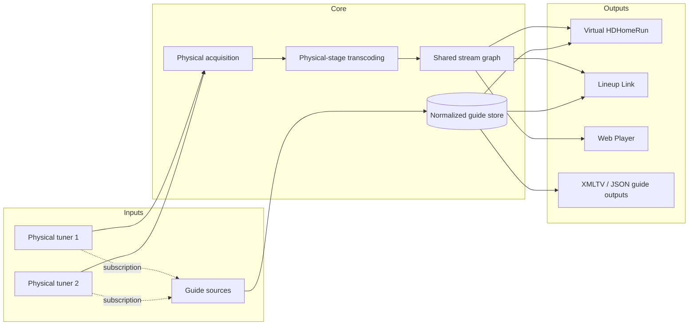

# Lineup architecture

Dependency roles, project responsibilities and contributor-facing architecture rules.

The built-in physical adapter currently supports [HDHomeRun](https://www.silicondust.com/) tuners such as the HDHomeRun FLEX 4K.
Provider-neutral Core contracts keep device, guide, streaming and virtual-output behavior outside the Web and TUI layers
and allow future adapters such as generic M3U sources or other network tuners.

- [Features](#features)
- [Architecture](#architecture)
- [Project Structure](#project-structure)

## Features

- **Automatic EPG fetching** — downloads SiliconDust's complete gzip-compressed XMLTV guide on the required randomized 20-28 hour schedule
- **Plugin-based guide outputs** — publishes normalized guide data atomically as global or scoped XMLTV and JSON files
- **Typed JSON guide contract** — exposes versioned `JsonGuideDocument` models, compact key-based supplemental metadata without embedded XML strings, and shared serialization helpers for downstream consumers
- **Per-channel availability** — keeps disabled channels visible in Lineup while excluding them from published guides, virtual lineups, and physical tuner streams
- **Live TV streaming** — multi-track MPEG-TS proxy and shared-CMAF HLS/DASH Watch playback with selectable audio and subtitles
- **Device diagnostics** — connectivity checks across DNS, ping, HTTP API, TCP, and UDP discovery
- **Streaming flow monitoring** — the Dashboard shows configured physical devices, processing stages, shared multiplexed producers, virtual outputs, and consumer sessions with active and warm paths highlighted
- **Application diagnostics** — live in-app structured logs, optional rolling files, and opt-in external observability targets
- **Localized Web interface** — serves first-party UI text in English or Spanish from standard .NET `.resx` resources with a persisted language preference under Regional Settings
- **Native HDHomeRun protocol** — binary protocol implementation for UDP discovery, TCP control, and channel scanning
- **Aggregated virtual HDHomeRun devices** — each virtual device can subscribe to all or selected physical tuners and publishes their combined capacity and lineup
- **Selectable output hosting** — Web Player, virtual HDHomeRun, and Lineup Link outputs can reuse the management host or run in isolated dedicated listeners
- **Lineup Link sharing** — securely shares selected channels, optional guide data, and post-output-transcode streams with other Lineup instances through independently managed access grants
- **Shared stream graph** — identical physical acquisitions and transforms are reference-counted and multiplexed across virtual devices and viewers
- **First-class guide sources** — named guide sources subscribe to all or selected compatible physical devices and provide authoritative channel bindings
- **Inherited transcoding profiles** — global physical and virtual defaults with sparse per-device overrides
- **Guide-output endpoints** — stable `/api/xmltv` and `/api/guide-outputs/{identifier}` routes serve global or scoped XMLTV/JSON documents; append `?download=false` to view a document inline instead of downloading it
- **Versioned status API** — `/api/v1/status` provides one stable guide, device, tuner, and stream snapshot for Home Assistant and other dashboards
- **Authoritative SQLite storage** — physical channels, enabled preferences, normalized EPG data, and configurable guide history are stored locally

## Architecture

Lineup models live TV as provider-neutral inputs, shared Core-owned processing, and independently configured outputs:

Physical and virtual devices inherit their stage's global transcoding defaults and may override individual settings. Each virtual device subscribes to all eligible physical devices by default or to an explicit subset. The shared stream graph reuses byte-identical acquisitions and transforms across outputs, then branches only where effective output settings differ.

Projects are organized by dependency role:

- `src/Apps` contains executable presentation hosts.
- `src/Core` contains the dependency-free shared model, stable plugin API, and provider-neutral application and streaming foundations.
- `src/Plugins` contains independently composable adapters and support libraries grouped by provider or product family (`SiliconDust`, `LineupLink`, and `WebPlayer`). These plugins are statically composed today and are structured for future dynamic loading.
- `tests` mirrors the same architecture.

`Lineup.Core.Common` is the dependency floor and contains only shared data types. `Lineup.Core.Extensibility` references `Lineup.Core.Common` and adds plugin/runtime interfaces and boundary validation. Adapters may consume designated support libraries from the same provider family, but they do not reference `Lineup.Core` application behavior.
Plugin family folders are organizational only; adapters and support libraries remain independently referenced assemblies.

See [Project Dependency Map](project-dependencies.md) for direct-reference diagrams and a purpose/usage catalog covering every production and test project in the solution.

### Apps

| Project | Description |
|---|---|
| `Lineup.App.Web` | Blazor Server presentation and HTTP transport composition |
| `Lineup.App.Tui` | Spectre.Console presentation and host composition |

### Core

| Project | Description |
|---|---|
| `Lineup.Core.Common` | Dependency-free identifiers, configuration records, normalized guide models, streaming DTOs, and serialized metadata types |
| `Lineup.Core` | Provider-neutral device, guide, topology, capacity, and shared-stream orchestration with authoritative SQLite storage |
| `Lineup.Core.Hosting` | Trusted topology/guide workers, stream shutdown, and graph/settings/storage adapters for portable media execution |
| `Lineup.Core.Extensibility` | Plugin/runtime interfaces, portable validation, and narrow host capabilities built on `Lineup.Core.Common` |
| `Lineup.Core.Streaming.FFmpeg` | Reusable FFmpeg/FFprobe process and streaming transforms |
| `Lineup.Core.VirtualOutputs.Protocol` | Versioned dependency-light local IPC contracts and bounded framing for isolated output workers |
| `Lineup.Core.VirtualOutputs.Hosting` | Worker-side bootstrap, authenticated broker client, and fail-closed lease lifecycle |
| `Lineup.Core.VirtualOutputs.Runtime` | Trusted worker provenance, activation, supervision, local IPC, and capability broker |

### Plugins

| Family | Project | Description |
|---|---|---|
| Guide Outputs | `Lineup.Plugin.GuideOutputs.Json` | Public versioned JSON guide document and serialization/deserialization API |
| Guide Outputs | `Lineup.Plugin.GuideOutputs.Json.Plugin` | JSON Guide Output driver, publisher adapter, settings, and host registration |
| Guide Outputs | `Lineup.Plugin.GuideOutputs.Xmltv` | Public serializer for normalized Lineup guide snapshots to XMLTV |
| Guide Outputs | `Lineup.Plugin.GuideOutputs.Xmltv.Plugin` | XMLTV Guide Output driver, global-output normalization, publisher adapter, and host registration |
| Lineup Link | `Lineup.Plugin.LineupLink` | Versioned remote-Lineup protocol plus physical input, virtual output, and optional guide-source adapters |
| Lineup Link | `Lineup.Plugin.LineupLink.VirtualOutputHost` | Dedicated per-device Lineup Link HTTP/HTTPS listener worker |
| SiliconDust | `Lineup.Plugin.SiliconDust.GuideSource` | Multi-device SiliconDust guide source adapter |
| SiliconDust | `Lineup.Plugin.SiliconDust.HDHomeRun.Api` | Remote API client — downloads XMLTV guide data from `api.hdhomerun.com` |
| SiliconDust | `Lineup.Plugin.SiliconDust.HDHomeRun.Device` | Local device communication — discovery, channel lineup, native binary protocol |
| SiliconDust | `Lineup.Plugin.SiliconDust.HDHomeRun.PhysicalTuner` | Multi-instance physical HDHomeRun adapter |
| SiliconDust | `Lineup.Plugin.SiliconDust.HDHomeRun.VirtualTuner` | Aggregated virtual HDHomeRun identity, discovery, lineup, and capacity behavior |
| SiliconDust | `Lineup.Plugin.SiliconDust.HDHomeRun.VirtualOutputHost` | Dedicated per-device HDHomeRun HTTP/HTTPS listener worker |
| SiliconDust | `Lineup.Plugin.SiliconDust.HDHomeRun.DiscoveryRuntime` | Trusted snapshot reconciler for the shared isolated discovery process |
| SiliconDust | `Lineup.Plugin.SiliconDust.HDHomeRun.DiscoveryHost` | Shared isolated UDP 65001 and SSDP 1900 discovery worker |
| Web Player | `Lineup.Plugin.WebPlayer` | Built-in Web Player contracts, browser capability policy, and shared CMAF output lifecycle |
| Web Player | `Lineup.Plugin.WebPlayer.FFmpeg` | FFmpeg CMAF planning, HLS/DASH manifest processing, and browser playback-test generation |
| Web Player | `Lineup.Plugin.WebPlayer.VirtualOutputHost` | Dedicated CMAF/HLS/DASH media listener and FFmpeg worker |

## Project Structure

Production and test projects are grouped by dependency role:

- `src/Apps` — executable Web and TUI hosts.
- `src/Core` — the dependency-free shared model, stable plugin API, and provider-neutral application and streaming foundations.
- `src/Plugins` — independently composable adapters and their support libraries, grouped by provider or product family (`SiliconDust`, `LineupLink`, and `WebPlayer`).
- `tests` — a hierarchy that mirrors the production project roles.

Project directories, `.csproj` filenames, root namespaces, and assembly names must agree. Use `Lineup.App.*` for application hosts, `Lineup.Core` or `Lineup.Core.*` for foundations, and `Lineup.Plugin.*` for plugin families and their support libraries.
Use `Lineup.Integration.*` for integration harnesses, `Lineup.TestSupport.*` for test helpers, and `Lineup.Tools.*` for build tools. Automated test projects use their subject project's name followed by `.Tests`, with the same root namespace.

`Lineup.Core.Common` has no project or package dependencies and contains only shared data types. `Lineup.Core.Extensibility` references only `Lineup.Core.Common` and contains plugin/runtime interfaces, portable diagnostics and boundary validation. Production plugin projects may reference it, the provider-neutral `Lineup.Core.Streaming.FFmpeg` foundation when media processing is required, and designated support libraries in the same provider family, but must not reference `Lineup.Core`.
Provider family folders are organizational only; every adapter and support library remains an independently referenced assembly. Support libraries may not depend on adapters or projects from another plugin family.

Architecture tests check direct production dependencies and transitive paths from portable libraries and worker executables to trusted host implementations.
`Lineup.Plugin.SiliconDust.HDHomeRun.DiscoveryRuntime` is a trusted host-side supervisor, not a portable worker, and may reference the trusted worker runtime.
`Lineup.Core.Streaming.FFmpeg` contains portable process execution, media probing, metadata policies, and immutable-profile planners.
Core graph leases, application settings, cached channel metadata, subtitle storage, and DI composition belong in
`Lineup.Core.Hosting.Streaming`. Portable media libraries and worker executables must not depend transitively on Core, hosting, EF, or SQLite.
There is no portable-media dependency exception.
Common and Extensibility remain package-free, and portable projects may not add direct Entity Framework or SQLite implementation packages.

## Related documentation

[Project overview](../README.md) | [Contributor standards](../CONTRIBUTING.md)
