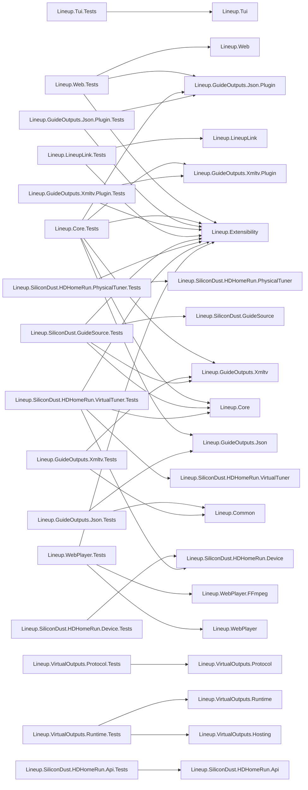

# Project Dependency Map

This document catalogs every project included in `Lineup.slnx`. An arrow points from a project to a direct project dependency:

```text
Consumer --> Dependency
```

NuGet packages and framework references are intentionally omitted. Transitive dependencies can be inferred by following arrows through the graph.

## Production dependency graph

```mermaid
flowchart TB
    subgraph Apps
        Web["Lineup.Web"]
        Tui["Lineup.Tui"]
    end

    subgraph Core
        Common["Lineup.Common"]
        Ext["Lineup.Extensibility"]
        CoreApp["Lineup.Core"]
        CoreHosting["Lineup.Core.Hosting"]
        FFmpeg["Lineup.Streaming.FFmpeg"]
        VOProtocol["Lineup.VirtualOutputs.Protocol"]
        VOHosting["Lineup.VirtualOutputs.Hosting"]
        VORuntime["Lineup.VirtualOutputs.Runtime"]
    end

    subgraph GuideOutputs
        GuideJson["Lineup.GuideOutputs.Json"]
        GuideJsonPlugin["Lineup.GuideOutputs.Json.Plugin"]
        GuideXmltv["Lineup.GuideOutputs.Xmltv"]
        GuideXmltvPlugin["Lineup.GuideOutputs.Xmltv.Plugin"]
    end

    subgraph LineupLink
        Link["Lineup.LineupLink"]
        LinkHost["Lineup.LineupLink.VirtualOutputHost"]
    end

    subgraph SiliconDust
        HdDevice["Lineup.SiliconDust.HDHomeRun.Device"]
        HdApi["Lineup.SiliconDust.HDHomeRun.Api"]
        HdPhysical["Lineup.SiliconDust.HDHomeRun.PhysicalTuner"]
        HdVirtual["Lineup.SiliconDust.HDHomeRun.VirtualTuner"]
        HdGuide["Lineup.SiliconDust.GuideSource"]
        HdDiscoveryRuntime["Lineup.SiliconDust.HDHomeRun.DiscoveryRuntime"]
        HdDiscoveryHost["Lineup.SiliconDust.HDHomeRun.DiscoveryHost"]
        HdOutputHost["Lineup.SiliconDust.HDHomeRun.VirtualOutputHost"]
    end

    subgraph WebPlayer
        Player["Lineup.WebPlayer"]
        PlayerFFmpeg["Lineup.WebPlayer.FFmpeg"]
        PlayerHost["Lineup.WebPlayer.VirtualOutputHost"]
    end

    Ext --> Common
    CoreApp --> Common
    CoreApp --> Ext
    CoreHosting --> CoreApp
    FFmpeg --> Ext
    FFmpeg --> CoreApp
    VOProtocol --> Common
    VOHosting --> Common
    VOHosting --> VOProtocol
    VORuntime --> Common
    VORuntime --> CoreApp
    VORuntime --> Ext
    VORuntime --> FFmpeg
    VORuntime --> VOProtocol

    GuideJson --> Common
    GuideJsonPlugin --> Common
    GuideJsonPlugin --> Ext
    GuideJsonPlugin --> GuideJson
    GuideXmltv --> Common
    GuideXmltvPlugin --> Common
    GuideXmltvPlugin --> Ext
    GuideXmltvPlugin --> GuideXmltv

    Link --> Ext
    LinkHost --> VOHosting
    LinkHost --> Link

    HdApi --> HdDevice
    HdPhysical --> Ext
    HdPhysical --> HdDevice
    HdVirtual --> Ext
    HdVirtual --> HdDevice
    HdGuide --> Ext
    HdGuide --> HdApi
    HdGuide --> HdDevice
    HdDiscoveryRuntime --> VORuntime
    HdDiscoveryRuntime --> HdVirtual
    HdDiscoveryHost --> VOHosting
    HdDiscoveryHost --> HdVirtual
    HdOutputHost --> VOHosting
    HdOutputHost --> HdVirtual

    Player --> Ext
    PlayerFFmpeg --> Ext
    PlayerFFmpeg --> FFmpeg
    PlayerFFmpeg --> Player
    PlayerHost --> VOHosting
    PlayerHost --> Player
    PlayerHost --> PlayerFFmpeg

    Web --> Ext
    Web --> CoreApp
    Web --> CoreHosting
    Web --> FFmpeg
    Web --> VORuntime
    Web --> GuideJsonPlugin
    Web --> GuideXmltvPlugin
    Web --> HdGuide
    Web --> Link
    Web --> HdPhysical
    Web --> HdVirtual
    Web --> Player
    Web --> PlayerFFmpeg
    Web --> HdDiscoveryRuntime

    Tui --> Ext
    Tui --> CoreApp
    Tui --> CoreHosting
    Tui --> FFmpeg
    Tui --> VORuntime
    Tui --> GuideJsonPlugin
    Tui --> GuideXmltvPlugin
    Tui --> HdGuide
    Tui --> Link
    Tui --> HdPhysical
    Tui --> HdVirtual
    Tui --> Player
    Tui --> HdDiscoveryRuntime
```



## Production project catalog

### Applications

| Project | Type | Purpose and usage | Direct project dependencies |
|---|---|---|---|
| `Lineup.Web` | Web executable | Blazor Server management UI, settings and status pages, guide browsing, Watch presentation, management-hosted virtual-output routes, and HTTP host composition. It statically composes the Core runtime and all currently shipped plugins. | `Lineup.Extensibility`, `Lineup.Core`, `Lineup.Core.Hosting`, `Lineup.Streaming.FFmpeg`, `Lineup.VirtualOutputs.Runtime`, both guide-output plugins, SiliconDust guide/physical/virtual/discovery plugins, `Lineup.LineupLink`, `Lineup.WebPlayer`, `Lineup.WebPlayer.FFmpeg` |
| `Lineup.Tui` | Console executable | Spectre.Console frontend for configuring and running the same Core topology, guide, streaming, plugin, and isolated-output infrastructure without the Web presentation layer. | Same host-neutral composition as Web except the TUI does not directly reference `Lineup.WebPlayer.FFmpeg` |

### Host-neutral foundations

| Project | Type | Purpose and usage | Direct project dependencies |
|---|---|---|---|
| `Lineup.Common` | Library | Dependency floor containing stable identifiers, configuration records, normalized guide and channel models, streaming DTOs, and serialized metadata shared across Core, plugins, hosts, and workers. | None |
| `Lineup.Extensibility` | Library | Stable plugin boundary: tuner, guide-source, guide-output, virtual-output, stream, settings, status, and host-capability interfaces plus portable validation primitives. | `Lineup.Common` |
| `Lineup.Core` | Library | Provider-neutral application behavior: topology and settings, device and guide orchestration, channel routing, capacity, shared stream multiplexing, transcoding policy, persistence, and status services. | `Lineup.Common`, `Lineup.Extensibility` |
| `Lineup.Core.Hosting` | Library | Reusable `IHostedService` composition for activating topology, refreshing devices, scheduling guide work, supervising runtime state, and shutting streams down cleanly in Web or TUI hosts. | `Lineup.Core` |
| `Lineup.Streaming.FFmpeg` | Library | Shared FFmpeg/FFprobe process control, media probing, MPEG-TS transforms, transcoding plans, synthetic streams, and process error handling. | `Lineup.Extensibility`, `Lineup.Core` |
| `Lineup.VirtualOutputs.Protocol` | Library | Versioned, dependency-light local IPC messages and bounded framing shared by the trusted host and isolated output/discovery workers. | `Lineup.Common` |
| `Lineup.VirtualOutputs.Hosting` | Library | Worker-side bootstrap and activation parsing, authenticated capability-broker client, lease renewal, TLS material loading, and fail-closed worker lifecycle. | `Lineup.Common`, `Lineup.VirtualOutputs.Protocol` |
| `Lineup.VirtualOutputs.Runtime` | Library | Trusted-host worker package verification, process activation and supervision, local IPC server, capability brokerage, enrollment, resource limits, restart policy, and runtime status. | `Lineup.Common`, `Lineup.Core`, `Lineup.Extensibility`, `Lineup.Streaming.FFmpeg`, `Lineup.VirtualOutputs.Protocol` |

### Guide outputs

| Project | Type | Purpose and usage | Direct project dependencies |
|---|---|---|---|
| `Lineup.GuideOutputs.Json` | Library | Public versioned JSON guide document contracts plus serialization and deserialization. It can be consumed independently of the Lineup application runtime. | `Lineup.Common` |
| `Lineup.GuideOutputs.Json.Plugin` | Library | Guide-output driver and publisher that converts normalized Core guide snapshots into the public JSON document and exposes plugin settings/registration. | `Lineup.Common`, `Lineup.Extensibility`, `Lineup.GuideOutputs.Json` |
| `Lineup.GuideOutputs.Xmltv` | Library | Public XMLTV serializer for normalized Lineup guide snapshots. It contains the format model rather than host or plugin behavior. | `Lineup.Common` |
| `Lineup.GuideOutputs.Xmltv.Plugin` | Library | XMLTV guide-output driver, global-output normalization, file publication, settings, and host registration. | `Lineup.Common`, `Lineup.Extensibility`, `Lineup.GuideOutputs.Xmltv` |

### Lineup Link

| Project | Type | Purpose and usage | Direct project dependencies |
|---|---|---|---|
| `Lineup.LineupLink` | Library | Complete remote-Lineup plugin family: versioned protocol and connection bundles, grant/token security, remote physical tuner client, virtual output provider, optional guide source, and stream/status contracts. | `Lineup.Extensibility` |
| `Lineup.LineupLink.VirtualOutputHost` | Worker executable | Dedicated HTTP/HTTPS process for one Lineup Link virtual output. It authenticates through the worker bootstrap channel and obtains bounded capabilities from the trusted host. | `Lineup.VirtualOutputs.Hosting`, `Lineup.LineupLink` |

### SiliconDust / HDHomeRun

| Project | Type | Purpose and usage | Direct project dependencies |
|---|---|---|---|
| `Lineup.SiliconDust.HDHomeRun.Device` | Library | Low-level local HDHomeRun support: device identity, UDP discovery, lineup/status HTTP communication, and native tuner/control protocol behavior. | None |
| `Lineup.SiliconDust.HDHomeRun.Api` | Library | Client for SiliconDust's remote API, including XMLTV guide retrieval and provider-specific API models. | `Lineup.SiliconDust.HDHomeRun.Device` |
| `Lineup.SiliconDust.HDHomeRun.PhysicalTuner` | Library | Physical tuner plugin that adapts one or more HDHomeRun devices into generic Lineup physical-device, channel, capacity, and stream-acquisition contracts. | `Lineup.Extensibility`, `Lineup.SiliconDust.HDHomeRun.Device` |
| `Lineup.SiliconDust.HDHomeRun.VirtualTuner` | Library | Virtual HDHomeRun output plugin: aggregated identity, tuner capacity, discover/lineup/device responses, stream URL construction, and advertisement snapshots. | `Lineup.Extensibility`, `Lineup.SiliconDust.HDHomeRun.Device` |
| `Lineup.SiliconDust.GuideSource` | Library | SiliconDust guide-source plugin that combines subscribed physical devices and remote API data into normalized Lineup guide snapshots. | `Lineup.Extensibility`, `Lineup.SiliconDust.HDHomeRun.Api`, `Lineup.SiliconDust.HDHomeRun.Device` |
| `Lineup.SiliconDust.HDHomeRun.DiscoveryRuntime` | Library | Trusted-host reconciler that converts enabled virtual HDHomeRun topology into bounded advertisements and supervises the shared discovery worker. | `Lineup.VirtualOutputs.Runtime`, `Lineup.SiliconDust.HDHomeRun.VirtualTuner` |
| `Lineup.SiliconDust.HDHomeRun.DiscoveryHost` | Worker executable | Shared isolated process that owns UDP 65001 and SSDP 1900 and advertises all eligible virtual HDHomeRun devices from trusted snapshots. | `Lineup.VirtualOutputs.Hosting`, `Lineup.SiliconDust.HDHomeRun.VirtualTuner` |
| `Lineup.SiliconDust.HDHomeRun.VirtualOutputHost` | Worker executable | Dedicated HTTP/HTTPS process serving one virtual HDHomeRun's discovery metadata, lineup, device XML, status, and MPEG-TS routes. | `Lineup.VirtualOutputs.Hosting`, `Lineup.SiliconDust.HDHomeRun.VirtualTuner` |

### Web Player

| Project | Type | Purpose and usage | Direct project dependencies |
|---|---|---|---|
| `Lineup.WebPlayer` | Library | Built-in Web Player contracts, virtual-output driver, browser/session models, compatibility policy, and shared CMAF output lifecycle abstractions. | `Lineup.Extensibility` |
| `Lineup.WebPlayer.FFmpeg` | Library | FFmpeg-backed CMAF generation, track planning, HLS/DASH manifest processing, subtitles, and browser compatibility-test media generation. | `Lineup.Extensibility`, `Lineup.Streaming.FFmpeg`, `Lineup.WebPlayer` |
| `Lineup.WebPlayer.VirtualOutputHost` | Worker executable | Dedicated Web Player media process serving CMAF/HLS/DASH sessions and obtaining stream capabilities from the trusted host. | `Lineup.VirtualOutputs.Hosting`, `Lineup.WebPlayer`, `Lineup.WebPlayer.FFmpeg` |

## Test dependency graph

The test graph shows direct project references from each test assembly. Production-to-production dependencies remain in the preceding graph.



## Test project catalog

| Project | Purpose and coverage | Direct project dependencies |
|---|---|---|
| `Lineup.Tui.Tests` | TUI portable-setting behavior, topology editing helpers, output-hosting derivation, and presentation-independent configuration mutations. | `Lineup.Tui` |
| `Lineup.Web.Tests` | Blazor components, controllers, settings editors, management-hosted routes, status APIs, playback/session behavior, and Web composition. | `Lineup.Web`, `Lineup.Extensibility`, `Lineup.GuideOutputs.Json.Plugin` |
| `Lineup.Core.Tests` | Core topology, persistence, guide normalization/publication, routing, capacity, stream sharing, policy, and startup schema behavior. | `Lineup.Extensibility`, `Lineup.Core`, both JSON guide projects, both XMLTV guide projects |
| `Lineup.VirtualOutputs.Protocol.Tests` | IPC message framing, versioning, size limits, and protocol serialization. | `Lineup.VirtualOutputs.Protocol` |
| `Lineup.VirtualOutputs.Runtime.Tests` | Worker bootstrap, authenticated IPC, capability brokerage, package validation, supervision, enrollment, leases, and resource policies. | `Lineup.VirtualOutputs.Hosting`, `Lineup.VirtualOutputs.Runtime` |
| `Lineup.GuideOutputs.Json.Tests` | Public JSON guide schema and serializer/deserializer behavior. | `Lineup.Common`, `Lineup.GuideOutputs.Json` |
| `Lineup.GuideOutputs.Json.Plugin.Tests` | JSON guide-output driver configuration and publication behavior. | `Lineup.Extensibility`, `Lineup.GuideOutputs.Json.Plugin` |
| `Lineup.GuideOutputs.Xmltv.Tests` | XMLTV format serialization and normalized model mapping. | `Lineup.Common`, `Lineup.GuideOutputs.Xmltv` |
| `Lineup.GuideOutputs.Xmltv.Plugin.Tests` | XMLTV plugin configuration, normalization, publication, and path behavior. | `Lineup.Extensibility`, `Lineup.GuideOutputs.Xmltv.Plugin` |
| `Lineup.LineupLink.Tests` | Protocol clients/contracts, bundle validation, grants, authentication, remote physical/virtual behavior, guide transfer, and worker-facing routes. | `Lineup.Extensibility`, `Lineup.LineupLink` |
| `Lineup.SiliconDust.GuideSource.Tests` | Multi-device guide acquisition, normalization, subscriptions, and XMLTV interoperability. | `Lineup.Extensibility`, `Lineup.Core`, `Lineup.GuideOutputs.Xmltv`, `Lineup.SiliconDust.GuideSource` |
| `Lineup.SiliconDust.HDHomeRun.Api.Tests` | Remote SiliconDust API request, response, and XMLTV parsing behavior. | `Lineup.SiliconDust.HDHomeRun.Api` |
| `Lineup.SiliconDust.HDHomeRun.Device.Tests` | Low-level discovery, identity, lineup, and native device protocol behavior. | `Lineup.SiliconDust.HDHomeRun.Device` |
| `Lineup.SiliconDust.HDHomeRun.PhysicalTuner.Tests` | Physical HDHomeRun adapter settings, channels, capacity, and stream acquisition. | `Lineup.Extensibility`, `Lineup.SiliconDust.HDHomeRun.PhysicalTuner` |
| `Lineup.SiliconDust.HDHomeRun.VirtualTuner.Tests` | Virtual HDHomeRun profile, aggregation, capacity, lineup, routing, and advertisement behavior. | `Lineup.Extensibility`, `Lineup.Core`, `Lineup.SiliconDust.HDHomeRun.Device`, `Lineup.SiliconDust.HDHomeRun.VirtualTuner` |
| `Lineup.WebPlayer.Tests` | Web Player contracts, session lifecycle, FFmpeg plans, CMAF/HLS/DASH output, subtitles, and compatibility media. | `Lineup.Extensibility`, `Lineup.WebPlayer`, `Lineup.WebPlayer.FFmpeg` |

## Dependency rules at a glance

- `Lineup.Common` is the dependency floor and must remain free of project and package dependencies.
- `Lineup.Extensibility` builds only on `Lineup.Common`; plugins depend on these stable contracts rather than on application hosts.
- `Lineup.Core` owns provider-neutral behavior. Web and TUI compose it but should not duplicate its streaming or topology logic.
- Format libraries such as `Lineup.GuideOutputs.Json` and `Lineup.GuideOutputs.Xmltv` remain separate from their plugin adapters so their document contracts can be reused independently.
- Isolated workers depend on `Lineup.VirtualOutputs.Hosting` and their own plugin family, not on Web, TUI, or the full trusted runtime.
- `Lineup.VirtualOutputs.Runtime` stays in trusted hosts and never runs inside an isolated worker.
- Test projects mirror the production hierarchy and may reference extra format/plugin projects only when needed for integration coverage.
